# AI Newsroom — Multi-Agent Newsletter System

**Working multi-agent editorial automation application | Architecture and selected Python components**

AI Newsroom is a working Python-based multi-agent application for researching and verifying news, drafting editorial content, generating audio scripts and preparing HTML newsletters through coordinated specialist agents and human-in-the-loop approval. This repository presents its architecture, workflow and engineering decisions.

> **Public repository scope:** Technical case study, application screenshots, architecture documentation, a synthetic example and selected standalone Python components. The complete end-to-end application is not included.

## Problem and approach

Producing a reliable technology newsletter involves repetitive research, comparing sources, preventing duplicate coverage, writing in a consistent voice, formatting cross-client HTML and reviewing the edition before sending it. A single unchecked model call does not provide reliable editorial governance.

The architecture separates responsibilities among three specialist stages, supported by deterministic validation and an explicit human-approval boundary.

## Architecture

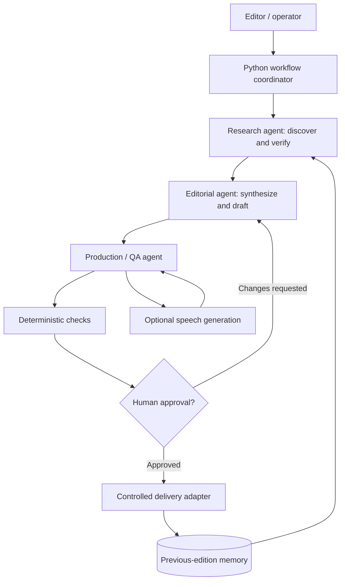

The diagram is architectural, not a claim that every stage executes autonomously without review.

## System capabilities

- Python-based orchestration of specialized editorial agents.
- Source-centered research and traceability of reported facts.
- Editorial memory to reduce repeated news across editions.
- Separation of research, synthesis, production and human authorization.
- HTML email assembly with compatibility considerations.
- Optional audio-script and speech-generation integration.
- A local interface for running, inspecting and approving editions.
- Persistence of edition state and explicit validation gates.

The system integrates model APIs, audio synthesis, object storage and email delivery. The standalone examples in this repository do not invoke external services.

## Public repository structure

```text
assets/
  diagrams/                  Architecture diagram source
docs/
  architecture.md            Components and data flow
  agent-workflow.md          Responsibilities and review gates
  case-study.md              Challenge, implementation and lessons
  technical-decisions.md     Engineering trade-offs
  security.md                Security architecture and boundaries
  limitations.md             What is and is not available
  roadmap.md                 Potential extensions
examples/
  synthetic-newsletter.md    Entirely fictional sample
src/ai_newsroom/
  __init__.py
  editorial_validation.py    Generic text/URL constraints
  workflow_states.py         Local edition lifecycle model
tests/
  test_public_components.py  Dependency-free unit tests
.env.example                 Placeholder settings only
.gitignore
LICENSE
README.md
```

## Selected Python components

The Python modules in `src/ai_newsroom` illustrate two reusable patterns: editorial input validation and conservative edition-state transitions.

Run the examples with Python 3.11+ (no API key required):

```bash
PYTHONPATH=src python -m unittest discover -s tests -v
```

For Windows PowerShell:

```powershell
$env:PYTHONPATH = "src"
python -m unittest discover -s tests -v
```

## Application preview

The screenshots illustrate the editorial workspace, specialized agents, article preparation, newsletter preview and approval workflow.

### Editorial workspace

The local interface coordinates three specialized agents and keeps an edition ready for human review.

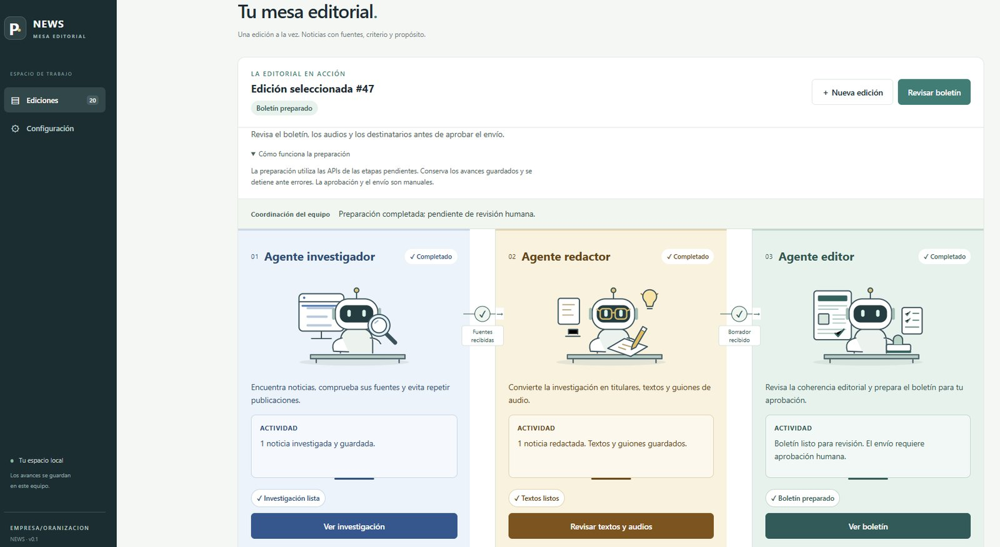

### Multi-agent workflow

The research, drafting and production stages have explicit statuses and handoffs.

| Start of workflow | Completed workflow |
| --- | --- |
| 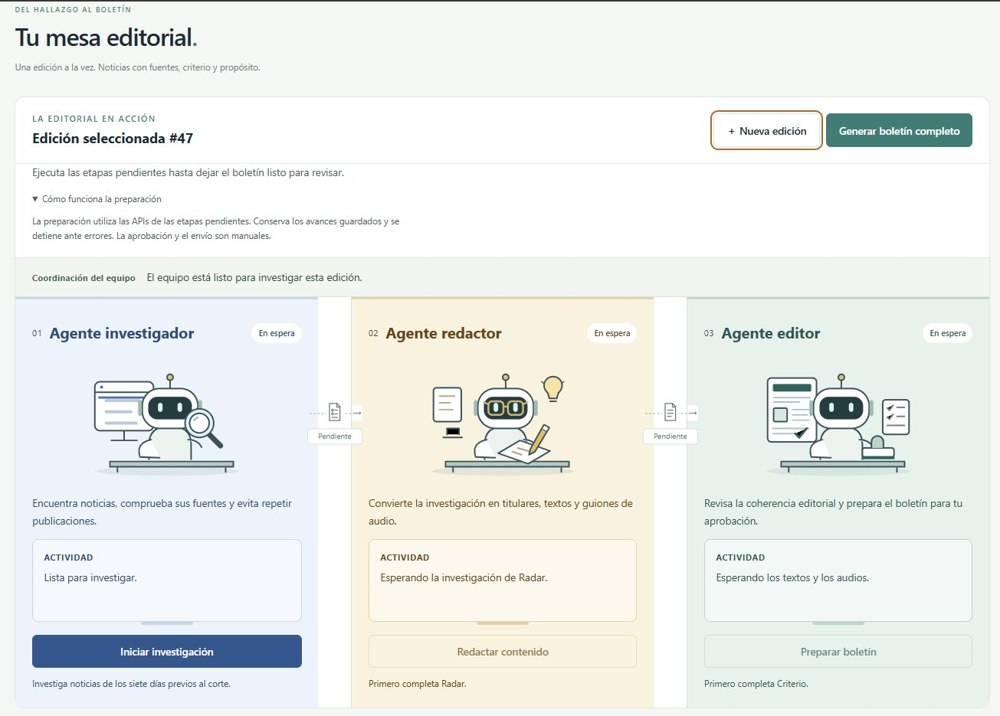 | 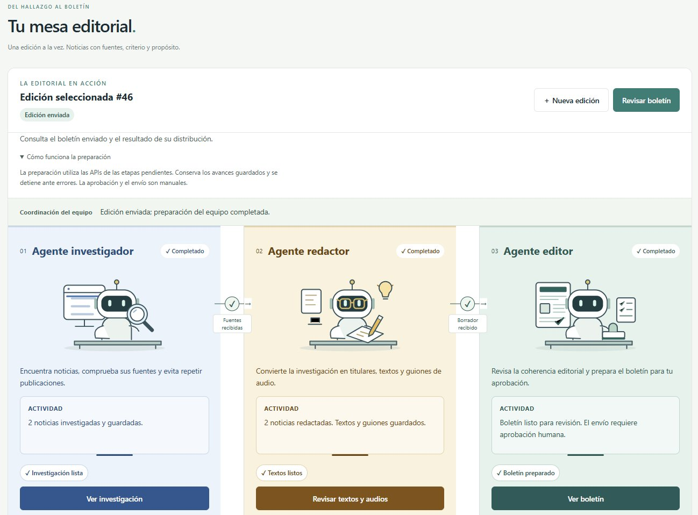 |

### Specialized agents

| Research agent | Editorial agent | Production / QA agent |
| --- | --- | --- |
|  | 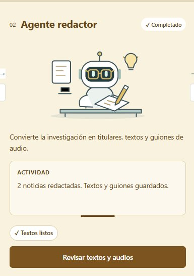 | 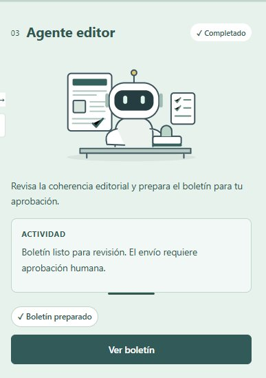 |

### Editorial content and newsletter output

The story review exposes article summaries, source references, practical implications and an audio narration script. The newsletter preview shows the formatted output before any delivery action.

**Structured editorial package**

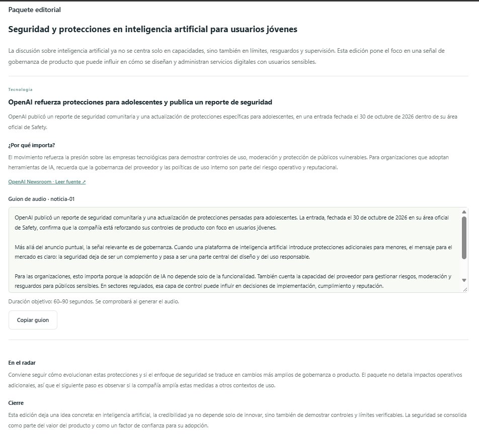

**Rendered email newsletter**

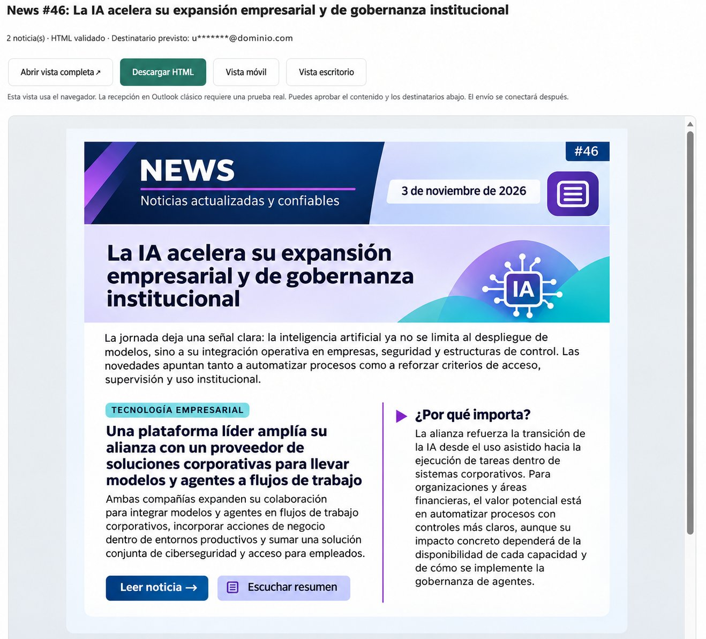

### Human approval and controlled delivery

Recipients and content must be reviewed before authorizing the edition. Test email and final delivery are presented as separate operations.

**Approval gate**

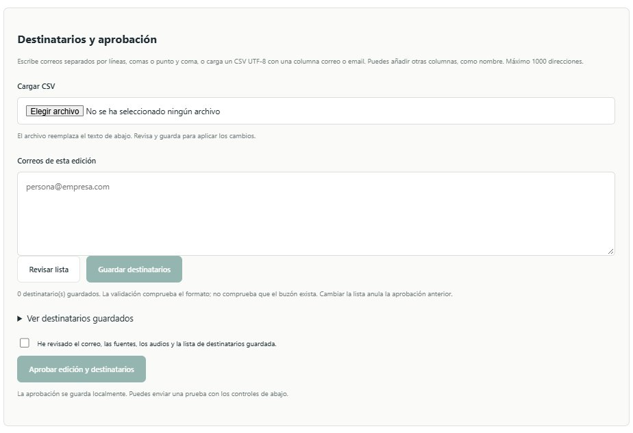

**Test and final delivery controls**

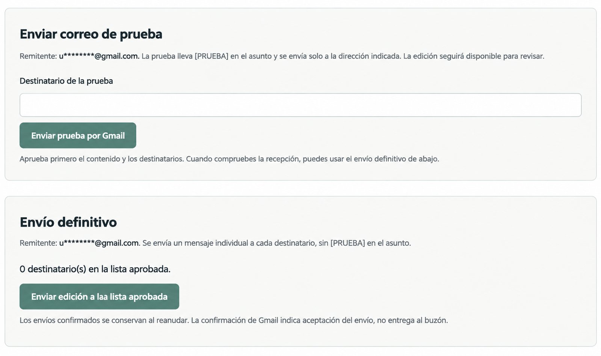

### Edition setup and research diagnostics

| Create a new edition | Research diagnostics |
| --- | --- |
| 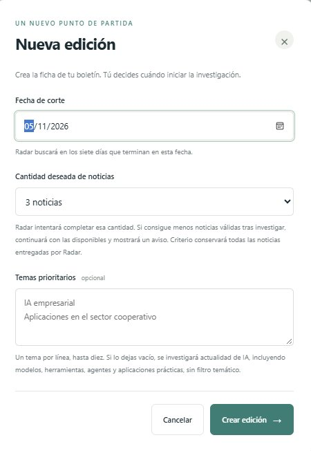 | 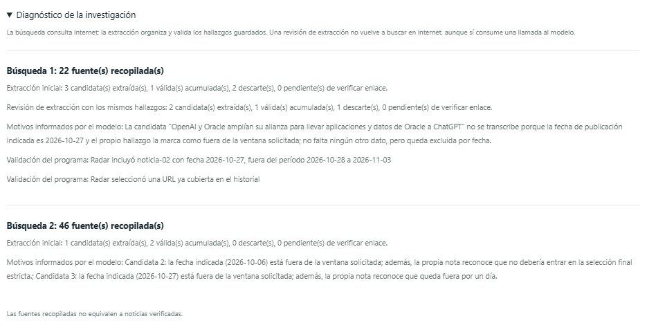 |


## Documentation

- [Case study](docs/case-study.md)
- [Architecture](docs/architecture.md)
- [Agent workflow and approval gates](docs/agent-workflow.md)
- [Technical decisions](docs/technical-decisions.md)
- [Security and privacy](docs/security.md)
- [Limitations](docs/limitations.md)
- [Roadmap](docs/roadmap.md)
- [Synthetic sample newsletter](examples/synthetic-newsletter.md)

## Security and privacy

The workflow separates research, editorial review, human authorization and external delivery. See [Security and privacy](docs/security.md) for the architectural safeguards and trust boundaries.

## Portfolio context

This project complements document RAG, MCP orchestration and privacy-by-design work by illustrating agent specialization, evidence handling, production validation and human-in-the-loop governance in an editorial workflow.

## License

[MIT](LICENSE) applies only to the content of **this public repository**, not to any private project or client deliverables.
