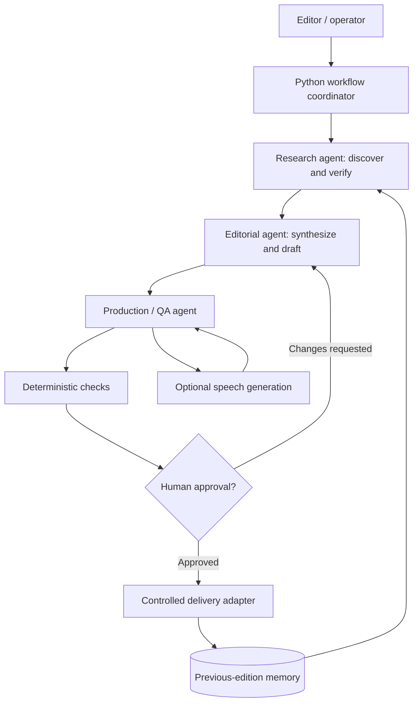

# AI Newsroom — Multi-Agent Newsletter System

**Public portfolio case study | Selected reconstructed components | Not the full private application**

AI Newsroom documents an AI-assisted editorial workflow that researches recent news, evaluates sources, produces accessible summaries, prepares audio scripts and assembles an email newsletter for human approval. This public repository presents the engineering approach behind a private working project, without releasing its original client configuration, templates, distribution records or source history.

> **Scope:** The source code here is a small, independent educational reconstruction of reusable validation and workflow concepts. It does **not** implement the complete multi-agent research, email delivery, audio generation or web application. The underlying private project is not included.

## Problem and approach

Producing a reliable technology newsletter involves repetitive research, comparing sources, preventing duplicate coverage, writing in a consistent voice, formatting cross-client HTML and reviewing the edition before sending it. A single unchecked model call does not provide reliable editorial governance.

The architecture separates responsibilities among three specialist stages, supported by deterministic validation and an explicit human-approval boundary.

## Architecture



The diagram is architectural, not a claim that every stage executes autonomously without review.

## What the private implementation demonstrates

- Python-based orchestration of specialized editorial agents.
- Source-centered research and traceability of reported facts.
- Editorial memory to reduce repeated news across editions.
- Separation of research, synthesis, production and human authorization.
- HTML email assembly with compatibility considerations.
- Optional audio-script and speech-generation integration.
- A local interface for running, inspecting and approving editions.
- Persistence of edition state and explicit validation gates.

External integrations in the private implementation include model APIs, audio synthesis, object storage and email. The public components do not call any external services.

## Public repository structure

```text
assets/
  diagrams/                  Architecture diagram source
docs/
  architecture.md            Components and data flow
  agent-workflow.md          Responsibilities and review gates
  case-study.md              Challenge, implementation and lessons
  technical-decisions.md     Engineering trade-offs
  security.md                Publication and runtime controls
  limitations.md             What is and is not available
  roadmap.md                 Potential extensions
examples/
  synthetic-newsletter.md    Entirely fictional sample
src/ai_newsroom/
  __init__.py
  editorial_validation.py    Generic text/URL constraints
  workflow_states.py         Local edition lifecycle model
tests/
  test_public_components.py  Dependency-free unit tests
.env.example                 Placeholder settings only
.gitignore
LICENSE
README.md
```

## Public code: small, testable, independent examples

The Python modules in `src/ai_newsroom` demonstrate two reusable patterns: validating editorial inputs and enforcing a conservative edition-state transition model. They are newly written for this portfolio and are **not** copies of the client-specific implementation.

Run the examples with Python 3.11+ (no API key required):

```bash
PYTHONPATH=src python -m unittest discover -s tests -v
```

For Windows PowerShell:

```powershell
$env:PYTHONPATH = "src"
python -m unittest discover -s tests -v
```

## Documentation

- [Case study](docs/case-study.md)
- [Architecture](docs/architecture.md)
- [Agent workflow and approval gates](docs/agent-workflow.md)
- [Technical decisions](docs/technical-decisions.md)
- [Security and privacy](docs/security.md)
- [Limitations](docs/limitations.md)
- [Roadmap](docs/roadmap.md)
- [Synthetic sample newsletter](examples/synthetic-newsletter.md)

## Security and client confidentiality

The public repository intentionally omits original branding and logos, recipient lists, private emails, real edition history, business-specific prompts, operational logs, internal domains, service endpoints, API keys, audio assets, private production HTML and the original repository's commit history. All examples are synthetic.

Publishing a sanitized technical reconstruction does not itself establish rights to disclose client-owned material. Confirm applicable ownership and contractual restrictions before adding original screenshots, implementation files or client-derived artifacts.

## Portfolio context

This project complements document RAG, MCP orchestration and privacy-by-design work by illustrating agent specialization, evidence handling, production validation and human-in-the-loop governance in an editorial workflow.

## License

[MIT](LICENSE) applies only to the content of **this public repository**, not to any private project or client deliverables.
