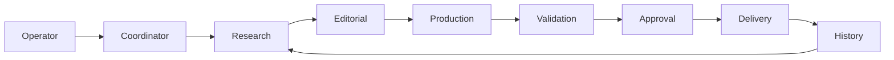

# Architecture

The private application uses a staged editorial workflow: an operator defines an edition; a research stage collects candidate stories and evidence; an editorial stage writes a coherent edition; production prepares formatted output and optional audio; deterministic checks and an explicit approval step precede any external delivery.

## Component boundaries

**Coordinator:** tracks edition identifiers, work progress and lifecycle; avoids treating model responses as authorization.

**Research stage:** obtains source evidence, compares publication dates and checks topic novelty against prior editions. Findings should retain links and evidence metadata.

**Editorial stage:** selects significant developments, distinguishes sourced facts from interpretation, drafts introduction, individual summaries, implications, closing and optional audio narration.

**Production stage:** converts approved structured content into an email-friendly presentation, checks placeholders and optional audio links, and prepares artifacts for review.

**Validation and human approval:** deterministic checks catch structural errors while editorial quality and authorization remain a human responsibility.

**Delivery adapter:** sends only a reviewed edition to an explicitly selected audience. Side effects belong outside the model's direct authority.

## Trust boundaries

Treat retrieved news and model outputs as untrusted. Keep credentials in local environment storage; avoid propagating private recipients into research prompts; separate review from external delivery; retain bounded logs without secret-bearing payloads.

This diagram documents a private system's pattern. Only small independent components of the pattern are implemented in this repository.